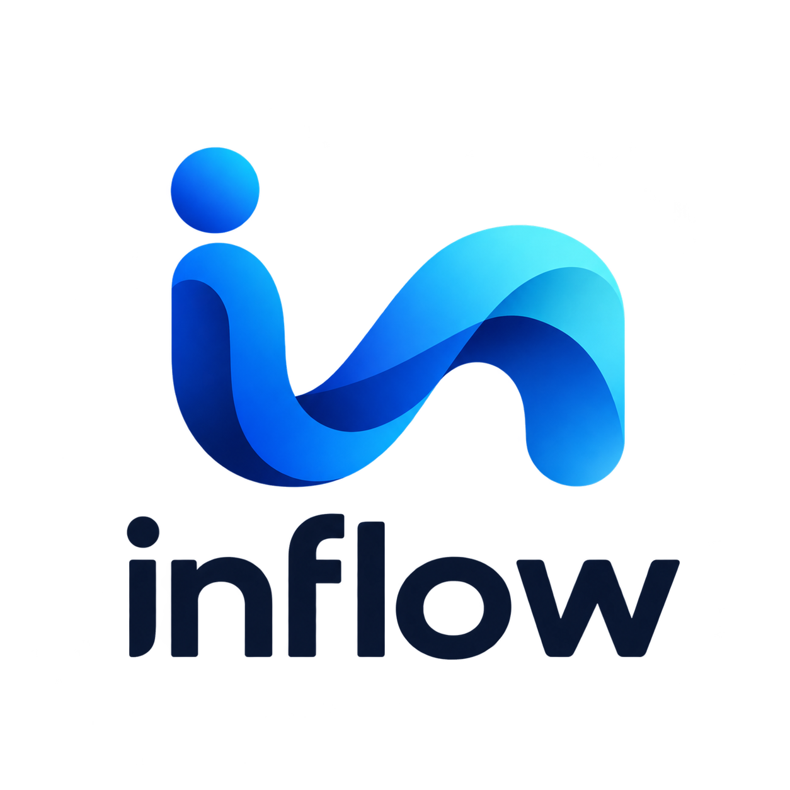
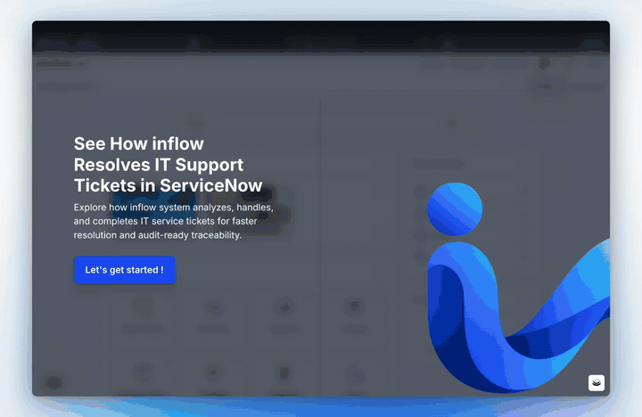
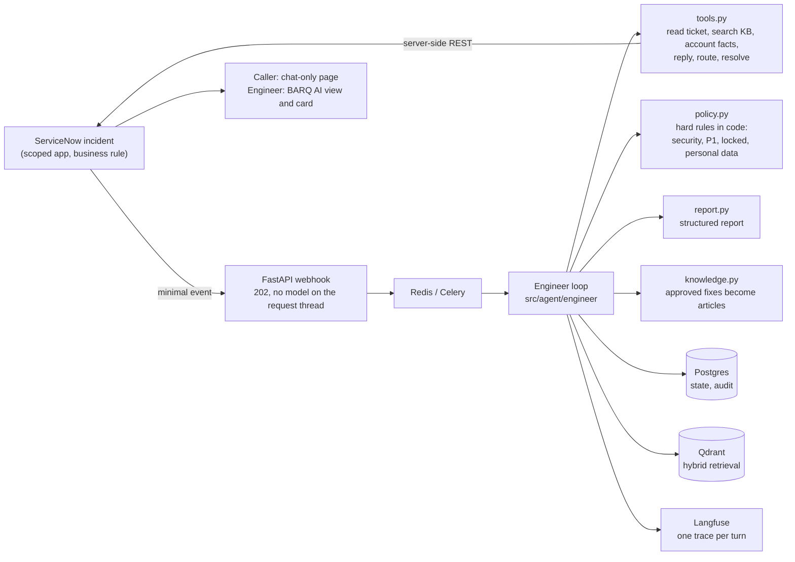

<p align="center">
  
</p>

# barq-agentic-it-engineer

An agentic IT engineer for ServiceNow incidents. A ticket arrives, the agent investigates it
like a human engineer would (reads the ticket, searches the knowledge base, checks the caller's
account, asks the caller questions in chat), decides what is safe to do on its own, acts, verifies,
and hands the ticket to a person when it should not decide alone.

This repository holds my own work for the BARQ x Sprints programme. It **builds on the programme's
team repository** (the incident-resolution platform the whole team wrote: webhook, queue,
retrieval, tracing, the scoped ServiceNow app). That base is included under `code/` because my
changes live inside it; see [Provenance and licence](#provenance-and-licence).

## Demo

[](https://github.com/ali-ezz/barq-agentic-it-engineer/releases/tag/v1.0-demo)

The preview above is the first 28 seconds. The full recordings are release assets (too large for git):

- [`inflow-demo-focused.mp4`](https://github.com/ali-ezz/barq-agentic-it-engineer/releases/download/v1.0-demo/inflow-demo-focused.mp4), 2 min 30 s, the cut shown on demo day (25 MB)
- [`inflow-demo.mp4`](https://github.com/ali-ezz/barq-agentic-it-engineer/releases/download/v1.0-demo/inflow-demo.mp4), 2 min 34 s, full version (98 MB)
- [`demo-day-draft-decks.zip`](https://github.com/ali-ezz/barq-agentic-it-engineer/releases/download/v1.0-demo/demo-day-draft-decks.zip), earlier deck drafts; the final deck is [`slides/Inflow-G1.pptx`](slides/Inflow-G1.pptx)

The release links work for everyone once the repository is public. The recordings have no narration and show
test data only: made-up employees and test tickets on my personal ServiceNow developer instance. The story, in order:
a locked account is checked and unlocked, then the caller confirms; an account that is *not* locked is not touched;
someone asking for a colleague's account, for admin rights, or injecting instructions is routed to security;
a hardware problem and a "let me talk to a person" request are handed to an engineer; then the Langfuse trace of a ticket
shows search, proposal, evidence check and the written result. Written talking points: [`docs/demo/`](docs/demo/).

## Architecture



- **Chat-only for callers.** No approve/reject buttons for the person who raised the ticket: they talk to the agent.
- **Engineer card with one button.** *Take over* / *Hand back*, an instruction box and *Undo*. No approval queue.
- **Hard policy.** Anything touching security, a priority-1 ticket, a locked ticket, or personal data is
  decided by code in `policy.py` and goes to a person; the model cannot talk its way past it.
- **Everything traced.** Every agent turn is a Langfuse trace linked from the card.
- Backend is selected with `AGENT_GRAPH_BACKEND=engineer`; the older fixed LangGraph pipeline from the team repo is still there.
- ServiceNow cannot call a plain-HTTP backend from the browser, so every call from the pages goes server-side through the instance.

## Run it

Needs Docker, [`uv`](https://docs.astral.sh/uv/), Python 3.12+ and a ServiceNow instance (I used a personal developer instance).

```bash
cd code
cp .env.engineer.example .env.pdi        # fill in the placeholders; never commit it
./pdi.sh up -d                           # api, worker, postgres, redis, qdrant (own containers, ports 18000/15432/16379/16333)
# ServiceNow must reach the API: expose it, e.g. cloudflared tunnel --url http://127.0.0.1:18000
python ../tools/setup_pdi.py <public-url>        # point the instance's event and token addresses at it
python ../tools/install_engineer_sn.py           # install the engineer UI pieces on the instance
```

The scoped ServiceNow app is in `code/servicenow/ai_incident_orchestrator` (built with the ServiceNow SDK).
`docs/DEMO_GUIDE.md` is the walk-through I used for the demo; `docs/HOW_IT_WORKS.md` explains the flow.

Unit tests (no Docker, no ServiceNow needed):

```bash
cd code
uv sync --all-extras --dev --locked
uv run ruff check . && uv run ruff format --check .
uv run pytest -q
```

## How it was tested

All numbers are from `docs/RESULTS.md` and the raw output in `evidence/` (live runs on my developer instance, October 2026):

| Check | Result |
|---|---|
| Scenario book, 16 real situations (true/false account lock, someone else's account, injection, password in the ticket, VPN, Outlook, hardware, vague, Arabic, talk to a person, cancel, still broken, engineer instruction, duplicate) | 16/16 (across runs) |
| Reply quality, a second model grades every reply | 4-5 / 5, all safe |
| Real-browser walk (chat, live status line, engineer card, take over / hand back, caller confirms) | 21/21 |
| Earlier fixed-pipeline suites: core, triage, conversation, permissions, engineer page, users' page, 22-case mix, real browser | 7/7, 4/4, 5/5, 12/12, 8/8, 10/10, 22/22, 18/18 |
| Unit tests at the time | 2,144 passed |
| Agent turn time | about 15-45 s |

The live suites need a configured instance and are in `code/scripts/live/`. Run from a fresh clone of this repo: ruff, ruff format and mypy are clean and `uv run pytest -q` gives 2,147 passed, 50 skipped, 30 deselected (the notes said 2,144 at the time of the live runs).

## Layout

| Path | What |
|---|---|
| `code/` | The working system: `src/` (API, workers, agent, engineer loop), `tests/`, `migrations/`, `servicenow/` (scoped app), `docker-compose*.yml`, `pdi.sh`, team docs under `code/docs/` (including the agentic platform design, `barq_agentic_platform_design.md`) |
| `tools/` | Instance setup and ops helpers: `setup_pdi.py`, `users_pdi.py`, `install_engineer_sn.py`, `allow_privs.py`, `trace.sh` (follow one ticket end to end), `sync_team.sh`, `servicenow_change_manifest.jsonl` (what the installer created) |
| `docs/` | `DEMO_GUIDE.md`, `HOW_IT_WORKS.md`, `PLAN.md`, `RESULTS.md`, `VIDEO_PLAN.md`, `PROJECT_NOTES.md` (technical history and decisions); `demo/` (demo-day talking points in Arabic and English, storyboards, two extra decks) |
| `evidence/` | Raw output and screenshots of the live test runs (`pdi-live-runs/ev*`, `regression-2026-10-03/`) |
| `slides/` | The demo-day deck |
| `media/` | Preview GIF and poster for this README |
| `archive/` | Earlier work kept for reference: `audit-2026-10-02/` (system audit, fixes as patches, runbook, PR descriptions), `shared-instance-audit/`, `servicenow-revert/`, `servicenow-research/`, `team-repo-stash0.patch` |

Scripts in `tools/` were written in a working folder laid out as `PDI/barq`, `PDI/tools`, `PDI/ev*`; their paths
now point at `code/`, `tools/` and `evidence/pdi-live-runs/`. `sync_team.sh` expects a git remote named `team`
for the team repository, which is not set up here.

## Status and limitations

- Built and tested on one personal ServiceNow developer instance, with a quick tunnel for the callback address. It is a prototype, not a production system.
- The live suites need a configured instance, a model endpoint and (optionally) a Langfuse project; only the unit tests run without them.
- Model calls go through a LiteLLM proxy; a free-tier Google AI Studio key is the fallback. Daily budgets limited how many live runs were possible.
- Not built: per-engineer identity for operator routes (a shared operator client is used), a CI evaluation gate, a forced-crash test, and remediation beyond account actions (runbooks, standard changes are designed in `code/docs/barq_agentic_platform_design.md`, not implemented).
- Numbers on the demo-day deck for caching savings are illustrative scenarios, not measured benchmarks; the deck says so.
- All values in `.env*.example` files and docs are placeholders. The instance name `dev434590` is my own developer instance.

## Provenance and licence

The base platform is the BARQ x Sprints team repository; its contributors wrote most of the original
pipeline, retrieval, tracing and ServiceNow app. My additions are the engineer loop and its policy
and report layers, the chat-only UI and engineer card, the ServiceNow installers in `tools/`, the
live scenario book and browser walk, and the audit work in `archive/`. The team repository carries
no licence file, so **no licence is granted here yet**; all rights stay with the respective authors.

## Credits

The platform under `code/` is the work of the BARQ x Sprints team: Kerolos Mohsen, Mohamed Abdelaiem, Tasneem Mohammed,
Ahmed Tamer and me, reviewed and coached by Aya Ashraf, with Mohamed Hatem as project admin. The programme's
team repository is private and not linked here.

